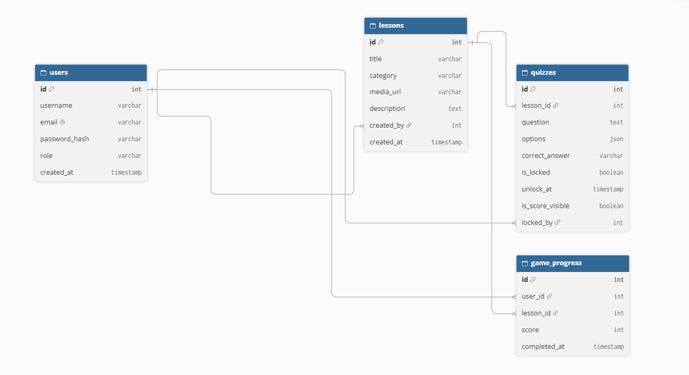

# 🤟 TeachSign

**TeachSign** adalah *Learning Management System* (LMS) berbasis web yang dirancang untuk pembelajaran bahasa isyarat secara interaktif melalui materi visual, evaluasi kuis, dan gamifikasi (*mini-games*). Platform ini dibuat secara efisien dan terstruktur menggunakan 4 tabel utama pada basis data.

---

## 👥 Anggota Kelompok

| No. | Nama                     | NPM            |
|:---:|:-------------------------|:--------------:|
| 1   | Raffi Fauzan             | `140810250067` |

---

## 🎯 Tujuan & Target Sustainable Development Goals (SDGs)

Pengembangan TeachSign berkontribusi pada pencapaian tujuan pembangunan berkelanjutan (**SDGs**), antara lain:

- **SDG 4: Pendidikan Berkualitas (Quality Education)**
  Memberikan edukasi bahasa isyarat yang berkualitas, interaktif, inklusif, dan mudah diakses oleh siapa saja.
- **SDG 10: Berkurangnya Kesenjangan (Reduced Inequalities)**
  Meningkatkan kesadaran dan jumlah masyarakat umum yang mahir menggunakan bahasa isyarat untuk mendorong aksesibilitas serta kesetaraan komunikasi bagi komunitas Tuli.

---

## 👨‍👩‍👧‍👦 Target Pengguna

- **Masyarakat Umum**
- **Masyarakat Unpad**

---

## 🖼️ Mockup Tampilan

---

## 🗄️ Skema Database

Sistem ini menggunakan **4 tabel utama** untuk mengelola seluruh data pengguna, materi, evaluasi kuis (termasuk kontrol kunci/buka dan tampil/sembunyi nilai), serta progres gamifikasi.

### 1. Tabel `users` (Manajemen Akun & Hak Akses)

| Kolom           | Tipe Data                  | Keterangan                       |
|:----------------|:---------------------------|:----------------------------------|
| `id`            | `INT` / `UUID`             | **Primary Key**                  |
| `username`      | `VARCHAR(50)`              | Nama pengguna                    |
| `email`         | `VARCHAR(100)`             | Email unik pengguna (**Unique**) |
| `password_hash` | `VARCHAR(255)`             | Hash kata sandi untuk keamanan   |
| `role`          | `ENUM('admin', 'student')` | Hak akses pengguna               |
| `created_at`    | `TIMESTAMP`                | Waktu pendaftaran                |

---

### 2. Tabel `lessons` (Konten Edukasi)

| Kolom         | Tipe Data       | Keterangan                                              |
|:--------------|:----------------|:----------------------------------------------------------|
| `id`          | `INT` / `UUID`  | **Primary Key**                                          |
| `title`       | `VARCHAR(100)`  | Judul materi/pelajaran                                   |
| `category`    | `VARCHAR(50)`   | Kategori materi (misal: Abjad, Angka, Kata Sehari-hari)  |
| `media_url`   | `VARCHAR(255)`  | URL berkas video/gambar gestur isyarat                   |
| `description` | `TEXT`          | Panduan detail gerakan tangan                            |
| `created_by`  | `INT` / `UUID`  | **Foreign Key** → `users.id`                             |
| `created_at`  | `TIMESTAMP`     | Waktu dibuat                                              |

---

### 3. Tabel `quizzes` (Soal Kuis & Kontrol Akses)

| Kolom              | Tipe Data                  | Keterangan                                              |
|:-------------------|:----------------------------|:---------------------------------------------------------|
| `id`               | `INT` / `UUID`              | **Primary Key**                                          |
| `lesson_id`        | `INT` / `UUID`              | **Foreign Key** → `lessons.id`                           |
| `question`         | `TEXT`                      | Teks pertanyaan kuis                                     |
| `options`          | `JSON`                      | Pilihan jawaban ganda                                    |
| `correct_answer`   | `VARCHAR(255)`              | Kunci jawaban                                             |
| `is_locked`        | `BOOLEAN`                   | `true` = kuis dikunci, siswa belum bisa mengerjakan       |
| `unlock_at`        | `TIMESTAMP` *(nullable)*    | Jadwal otomatis kebuka (opsional, untuk auto-unlock)      |
| `is_score_visible` | `BOOLEAN`                   | `true` = nilai kuis boleh dilihat siswa                   |
| `locked_by`        | `INT` / `UUID` *(nullable)* | **Foreign Key** → `users.id`, admin terakhir yang mengubah status |

---

### 4. Tabel `game_progress` (Progres & Nilai Mini-Game)

| Kolom          | Tipe Data      | Keterangan                       |
|:----------------|:----------------|:-----------------------------------|
| `id`           | `INT` / `UUID` | **Primary Key**                  |
| `user_id`      | `INT` / `UUID` | **Foreign Key** → `users.id`     |
| `lesson_id`    | `INT` / `UUID` | **Foreign Key** → `lessons.id`   |
| `score`        | `INT`          | Skor kuis/game                   |
| `completed_at` | `TIMESTAMP`    | Waktu selesai                    |

## 🗄️ ERD

